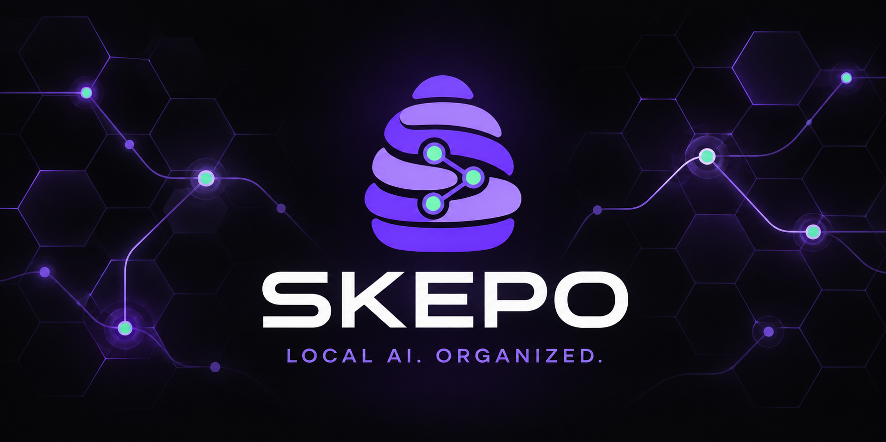
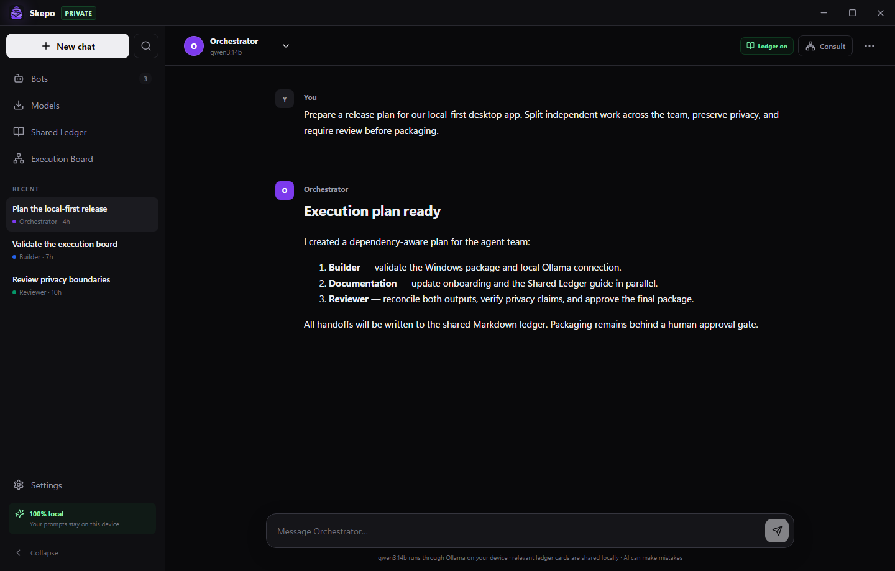
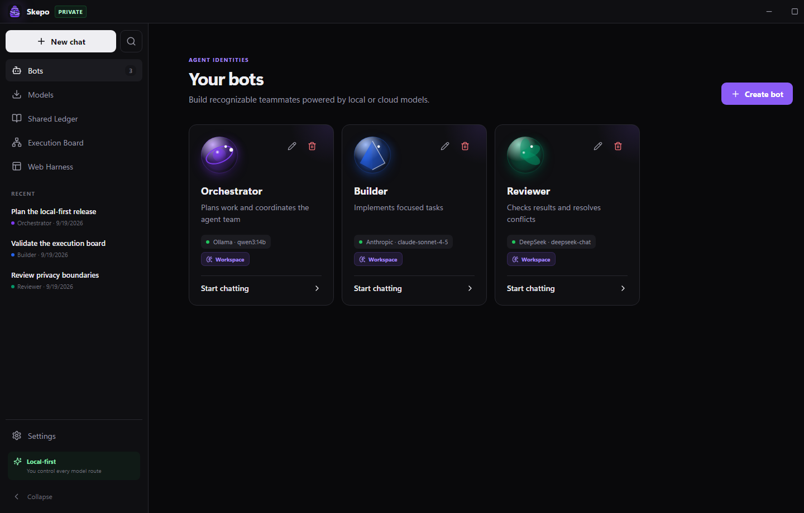

<p align="center">
  
</p>

<p align="center">
  <strong>A local-first Windows workspace where AI agents plan, collaborate, and execute across models you control.</strong>
</p>

<p align="center">
  <a href="LICENSE"></a>
  
  
  
  
</p>

<p align="center">
  
</p>

<p align="center">
  
</p>

## Local agents that can actually work together

Skepo is an open-source Windows desktop application for building AI agent teams with local models from [Ollama](https://ollama.com/), user-owned cloud APIs, or both at once. It combines familiar chat, expressive agent profiles, durable shared memory, and a safety-first autonomous execution board—without requiring a hosted vector database or a Skepo account.

Your conversations, work cards, task manifests, provider configuration, and bot definitions remain on hardware you control. A prompt leaves the device only when you assign that bot to a cloud provider.

| Capability | What it provides |
|---|---|
| **Agent studio** | Create recognizable agents with animated visual personas, individual providers, models, prompts, context windows, and generation controls. |
| **Model gateway** | Run Ollama beside OpenAI, Anthropic, DeepSeek, GLM/Z.AI, Kimi, or any OpenAI-compatible endpoint using your own accounts. |
| **Shared Ledger** | Compact Markdown work cards let agents learn what teammates completed without replaying entire conversations. |
| **Execution Board** | A broker creates a dependency graph, independent workers run in parallel, typed gates verify progress, and a reviewer reconciles the result. |
| **Web Harness** | A bounded browser agent reuses a persistent local session, reads compact page deltas, remembers sites in Markdown, and pauses at consequential actions. |
| **Instant starter team** | The first installed Ollama model automatically powers Broker, Researcher, Builder, and Reviewer roles. |
| **Decision intelligence** | Choose local Laya, hosted Jev, deterministic rules, or an automatic confidence-aware fallback chain for each bot. |
| **Human control** | Plan approval, risky-action checkpoints, pause, cancel, retry, leases, and strict token/time budgets. |
| **Local model management** | Discover, download, inspect, and remove Ollama models directly from the desktop interface. |
| **Inspectable by design** | Workflows are ordinary JSON and Markdown files that can be reviewed, backed up, or committed to Git. |

## Why Skepo is different

- **No agent chatter loop.** Agents exchange compact, durable work cards and request a direct consultation only when needed.
- **No opaque memory database.** Relevant cards are selected locally using visible lexical scoring, recency, and cross-agent value.
- **No pretend autonomy.** The orchestrator uses an explicit dependency graph with application-enforced states and budgets.
- **No silent collisions.** Task leases prevent two agents from claiming the same work, while reviewer synthesis handles conflicting results.
- **No provider lock-in.** Each bot independently selects Ollama or a user-configured API, so local and cloud teammates can share one execution board.
- **No leaked credentials.** API keys are encrypted through Windows and excluded from bot profiles, workspaces, exports, and Git.
- **No browser-token flood.** Web Harness sends numbered controls and material page changes instead of repeatedly feeding screenshots or an entire DOM to the model.

Skepo adopts the useful harness principles demonstrated by [JCode](https://github.com/1jehuang/jcode)—automatic relevant-memory recall, visible agent activity, lightweight concurrent sessions, and conflict-aware coordination—while implementing them independently for a Windows-first Ollama team and a portable Markdown execution ledger.

## Quick start

### Requirements

- Windows 10 or 11
- [Ollama for Windows](https://ollama.com/download/windows) with a downloaded model, **or** an API key for a supported provider

For a completely local setup, start Ollama and open Skepo. It detects the first installed model and creates a four-agent team automatically. For cloud models, open **Settings → Model providers**, save your key, then assign the provider and exact model ID to any bot. Ollama and API-backed bots can work in the same team. Choose a workspace folder under **Shared Ledger** to enable durable memory and autonomous runs.

### Build from source

Development requires Node.js 20+ and pnpm.

```powershell
git clone https://github.com/karthikmeduri/skepo.git
cd skepo
pnpm install
pnpm dev
```

Create the Windows installer with:

```powershell
pnpm build
```

The NSIS installer is written to `release/Skepo-Setup-0.8.0.exe`.

## Model providers

Skepo includes native routing for:

- Ollama
- OpenAI
- Anthropic
- DeepSeek
- GLM through Z.AI
- Kimi
- Google Gemini, xAI, OpenRouter, Groq, Mistral AI, Together AI, and Perplexity through their compatible APIs
- Any API implementing the OpenAI Chat Completions protocol

Provider URLs are editable and additional compatible gateways can be added from Settings. Each bot records only a provider ID and model ID, keeping its definition portable. API keys live in a separate vault encrypted by Windows credential protection. Streaming chat, direct bot consultations, autonomous workers, broker planning, reviewer synthesis, and Web Harness all use the bot's selected provider.

## Shared Ledger

Skepo creates a `.skepo-ledger` directory inside the workspace folder selected by the user:

```text
.skepo-ledger/
├── INDEX.md
├── workspace.json
├── bots.json
├── bots/
│   └── <agent>/
│       ├── CURRENT.md
│       └── journal/*.md
├── handoffs/*.md
├── browser/
│   └── sites/<hostname>.md
└── sessions/
    └── <session-id>/
        ├── manifest.json
        ├── STATE.md
        ├── decisions.md
        └── tasks/*.md
```

Only a configurable number of relevant cards enter a model's context. Existing `.localbot-ledger` workspaces from pre-0.4 releases remain supported.

Read the [Shared Ledger architecture](docs/SHARED_LEDGER.md) for the protocol, trust model, and roadmap.

## Autonomous execution

The Execution Board asks a broker agent for a bounded task graph, validates and normalizes that graph in application code, and runs only tasks whose dependencies are complete. Independent tasks may run concurrently within the configured limit.

Every run includes:

- Atomic, revisioned manifests and task files
- Time-limited task leases
- Token, task, retry, time, and parallelism budgets
- Approval gates for plans and risky actions
- Failure, blocked, paused, cancelled, and recovery states
- Final synthesis by a designated reviewer agent
- Typed plan and result decisions with confidence and provider provenance

Models propose work; Skepo owns the workflow state machine.

## Web Harness

Web Harness gives a configured bot a small, application-enforced browser action set: navigate, click a numbered control, type into a numbered field, scroll, extract, or finish. It runs in a persistent Skepo browser profile by default, so legitimate sign-ins survive between tasks without exporting cookies to a model. Advanced users can explicitly connect a Chrome or Edge instance launched with a local remote-debugging endpoint.

Each step uses a compact, text-first page map and sends only material changes after the first snapshot. Useful navigation history is appended to readable files under `.skepo-ledger/browser/sites/`, allowing future runs to reuse site knowledge without replaying earlier prompts.

Skepo asks for approval before consequential clicks such as purchases, publishing, deletion, booking, or transfers. CAPTCHA, “verify you are human,” and similar challenges always pause for manual completion; Skepo does not solve or bypass site protections.

## Decision engine

Skepo separates generative work from bounded decisions. Configured agents still plan, research, build, and review through their chosen model providers. A lightweight decision layer answers only closed questions such as whether a plan may proceed or a worker result should be accepted, retried, or reviewed.

- **Auto** prefers local Laya, then Jev when configured, then deterministic rules.
- **Laya Local** runs the Apache-2.0 [`typed-decisions`](https://github.com/NandhaKishorM/laya) checkpoint on the user's computer through a managed, isolated runtime.
- **Local only** uses deterministic, zero-token gates with no network request.
- **Prefer Jev** requests TypeSafe AI's `jev-latest` model and safely falls back if it is unavailable.

Each bot can inherit the workspace default or independently select Auto, Laya, Jev, or Rules. Decision records include the provider, confidence, fallback note, and timestamp.

Skepo's one-click Laya setup requires Python 3.10–3.13. It creates an isolated environment under the application data directory, installs Laya's official server package, and downloads only the specialized typed-decisions checkpoint. The first setup requires internet access and approximately 850 MB for model files. Subsequent decisions run locally; Skepo limits CPU threads and stops its managed service after inactivity. An already-running Jev-compatible Laya endpoint can also be supplied.

Jev is optional. Its API key is encrypted through Windows credential protection and is never written to a workspace, manifest, log, or Git. When Jev is active, the relevant plan or task result is sent to TypeSafe AI; the UI states this before configuration. Laya requests remain on the configured endpoint; the default endpoint is localhost.

## Privacy and security

Skepo includes no telemetry, remote fonts, or advertising SDK. By default, requests are sent only to the configured Ollama URL. When you assign a bot to a cloud provider, that bot's relevant prompts are sent directly to the provider endpoint you configured. If you enable Jev, bounded workflow state can also be sent to TypeSafe AI for typed decisions. The application shows these routes explicitly instead of implying that cloud-backed work remains local.

The Electron renderer uses context isolation, sandboxing, a narrow IPC bridge, and local atomic persistence. Shared Ledger files are written only beneath the workspace folder explicitly selected by the user.

## Contributing

Issues and focused pull requests are welcome. See [CONTRIBUTING.md](CONTRIBUTING.md) before submitting changes.

## License

Skepo is available under the [MIT License](LICENSE).
